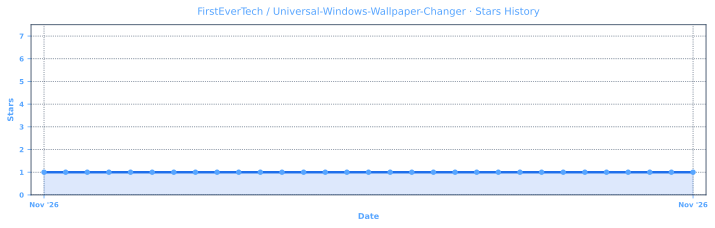
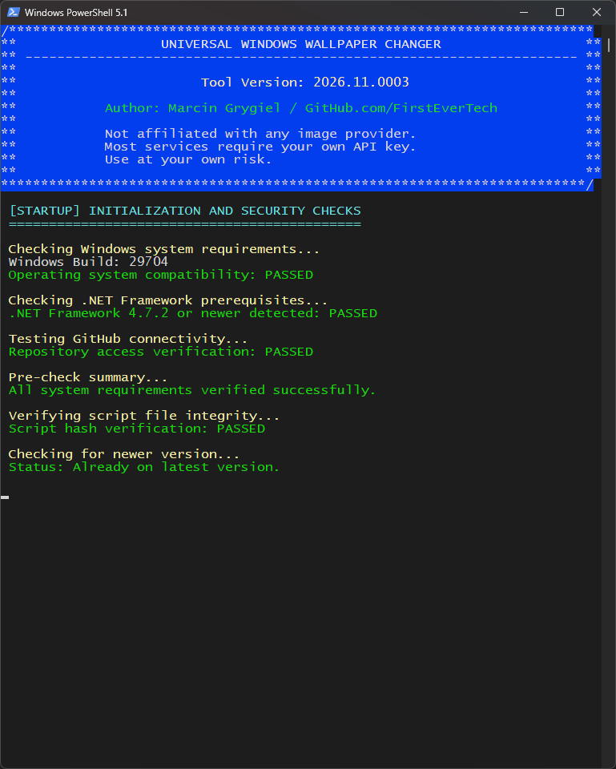

  <a href="README.md">🇬🇧 English</a> |
  <a href="https://translate.google.com/translate?sl=en&tl=pl&u=https://github.com/FirstEverTech/Universal-Windows-Wallpaper-Changer">🇵🇱 Polski</a> |
  <a href="https://translate.google.com/translate?sl=en&tl=de&u=https://github.com/FirstEverTech/Universal-Windows-Wallpaper-Changer">🇩🇪 Deutsch</a> |
  <a href="https://translate.google.com/translate?sl=en&tl=fr&u=https://github.com/FirstEverTech/Universal-Windows-Wallpaper-Changer">🇫🇷 Français</a> |
  <a href="https://translate.google.com/translate?sl=en&tl=es&u=https://github.com/FirstEverTech/Universal-Windows-Wallpaper-Changer">🇪🇸 Español</a> |
  <a href="https://translate.google.com/translate?sl=en&tl=pt&u=https://github.com/FirstEverTech/Universal-Windows-Wallpaper-Changer">🇧🇷 Português</a> |
  <a href="https://translate.google.com/translate?sl=en&tl=nl&u=https://github.com/FirstEverTech/Universal-Windows-Wallpaper-Changer">🇳🇱 Nederlands</a>
   
  <a href="https://translate.google.com/translate?sl=en&tl=zh-CN&u=https://github.com/FirstEverTech/Universal-Windows-Wallpaper-Changer">🇨🇳 中文</a> |
  <a href="https://translate.google.com/translate?sl=en&tl=ja&u=https://github.com/FirstEverTech/Universal-Windows-Wallpaper-Changer">🇯🇵 日本語</a> |
  <a href="https://translate.google.com/translate?sl=en&tl=ko&u=https://github.com/FirstEverTech/Universal-Windows-Wallpaper-Changer">🇰🇷 한국어</a> |
  <a href="https://translate.google.com/translate?sl=en&tl=it&u=https://github.com/FirstEverTech/Universal-Windows-Wallpaper-Changer">🇮🇹 Italiano</a> |
  <a href="https://translate.google.com/translate?sl=en&tl=tr&u=https://github.com/FirstEverTech/Universal-Windows-Wallpaper-Changer">🇹🇷 Türkçe</a> |
  <a href="https://translate.google.com/translate?sl=en&tl=ar&u=https://github.com/FirstEverTech/Universal-Windows-Wallpaper-Changer">🇸🇦 العربية</a> |
  <a href="https://translate.google.com/translate?sl=en&tl=hi&u=https://github.com/FirstEverTech/Universal-Windows-Wallpaper-Changer">🇮🇳 हिन्दी</a> |
  <a href="https://translate.google.com/translate?sl=en&tl=ru&u=https://github.com/FirstEverTech/Universal-Windows-Wallpaper-Changer">🇷🇺 Русский</a>

# 🖼️ **Universal Windows Wallpaper Changer**

  

## 🔧 Set a Fresh 4K Wallpaper on Windows — Once, or on a Schedule
**Universal Windows Wallpaper Changer** downloads a random, free high-resolution wallpaper (4K by default) from a free image service (or picks one from your own folder) and applies it as the Windows desktop wallpaper. Runs once, or keeps changing in the background with a tray icon.

This project was built through a pragmatic collaboration between human expertise and AI-assisted tooling.

### Why This Tool Exists
Windows has no built-in way to rotate wallpapers from multiple free sources without third-party bloatware. This tool gives you a zero-config way to keep your desktop fresh — with no API keys required for the default sources and no administrator rights.

---

For detailed documentation and guides, see:  
→ **[How the image filter pipeline works](#73-download--filter-pipeline)**  
→ **[Deploying via MDM / silent mode](#92-it-professionals)**  
→ **[Security and verification](#8-security-first-approach)**  

👉 [Share your feedback!](https://github.com/FirstEverTech/Universal-Windows-Wallpaper-Changer/issues)

---

## 💖 Support This Project

**Universal Windows Wallpaper Changer** is free and open-source — maintained by a single developer.  
The provider integrations, background mode and image filtering pipeline are maintained in my free time.

If this tool saved you time or made your desktop a little nicer — consider supporting development. 🎯 **[Follow on Patreon for free](https://www.patreon.com/FirstEverTech)** — stay updated on new releases and development progress.

## 🏢 Sponsors
*No sponsors yet — [be the first and add your company ad!](https://www.patreon.com/c/firstevertech/membership)*

## ❤️ Supporters

A huge thank you to all our supporters – your contributions make a real difference.  
Your name could be here too. Every bit helps cover development costs and ensures these tools continue to improve.

<!-- SUPPORTERS_START -->
- Sqania, jadeanemail, westor7, J. A. Dean, Bartechr, tsantaliki, PegHorse
<!-- SUPPORTERS_END -->

## ⭐ Stars
If this project helped you, please click the "Star" button at the top of this page on GitHub.

## 🌐 Community & Distribution

- Official threads on forums:  
🔗 **TechPowerUp**, **Guru3D**, **WinClub**, **ElevenForum**, **Win-Raid**, and **Station-Drivers**.

## 💼 Career Opportunity

> [!TIP]
> **I specialize in Windows deployment, driver automation, hardware compatibility, Microsoft technologies, infrastructure analysis, and custom IT tooling. If your organization faces automation, deployment, device management, or unsupported hardware environments, let's discuss how I can help.**
>
> 🔗 **Business Contact:** [firstever.tech/contact](https://www.firstever.tech/contact)
> 🔗 **LinkedIn Profile:** [linkedin.com/in/marcin-grygiel](https://linkedin.com/in/marcin-grygiel)

---

## 📑 **1. Table of Contents**

1. [**Table of Contents**](#table_of_contents)  
2. [**Release Highlights**](#release-highlights)  
   2.1 [Latest Version](#latest-version)  
   2.2 [Previous Release](#previous-releases)  
3. [**Application Overview**](#application-overview)  
4. [**Key Features**](#key-features)  
   4.1 [Multiple Free Sources](#multiple-free-sources)  
   4.2 [Background Mode](#background-mode)  
   4.3 [Security & Verification](#security-verification)  
   4.4 [Customization](#customization)  
5. [**System Requirements**](#system-requirements)  
   5.1 [System Requirements Table](#system-requirements-table)  
   5.2 [Windows Version Support](#windows-version-support)  
   5.3 [Legacy System Notes](#legacy-system-notes)  
6. [**Quick Start**](#quick-start)  
   6.1 [Method 1: Interactive Start Screen](#method-1-interactive-start-screen)  
   6.2 [Method 2: One Random Wallpaper](#method-2-one-random-wallpaper)  
   6.3 [Method 3: Background Changer](#method-3-background-changer)  
   6.4 [Method 4: PowerShell Gallery](#method-4-powershell-gallery)  
   6.5 [Command-Line Options](#command-line-options)  
7. [**How It Works**](#how-it-works)  
   7.1 [Self-Verification & Update Check](#self-verification-update-check)  
   7.2 [Image Source Selection](#image-source-selection)  
   7.3 [Download & Filter Pipeline](#download-filter-pipeline)  
   7.4 [Wallpaper Application](#wallpaper-application)  
   7.5 [JPEG Import Quality (Windows 11)](#jpeg-import-quality)  
8. [**Security First Approach**](#security-first-approach)  
   8.1 [Verified Security Layers](#verified-security-layers)  
9. [**Usage Scenarios**](#usage-scenarios)  
   9.1 [Home Users](#home-users)  
   9.2 [IT Professionals](#it-professionals)  
   9.3 [System Builders](#system-builders)  
10. [**Download Options**](#download-options)  
    10.1 [Option 1: SFX Executable (Recommended)](#option-1-sfx-executable-recommended)  
    10.2 [Option 2: Direct PS1](#option-2-direct-ps1)  
    10.3 [Option 3: PowerShell Gallery](#option-3-powershell-gallery)  
    10.4 [Option 4: Source Code](#option-4-source-code)  
11. [**Project Structure**](#project-structure)  
12. [**Release Structure**](#release-structure)  
    12.1 [Primary Files](#primary-files)  
    12.2 [Verification Files](#verification-files)  
    12.3 [Data Files](#data-files)  
13. [**Frequently Asked Questions (FAQ)**](#frequently-asked-questions-faq)  
14. [**Image Source Comparison**](#image-source-comparison)  
15. [**Performance Metrics**](#performance-metrics)  
    15.1 [Typical Execution Time Breakdown](#typical-execution-times)  
    15.2 [Disk Space Usage](#disk-space-usage)  
16. [**Known Issues**](#known-issues)  
17. [**Ready to Use?**](#ready-to-use)  
    17.1 [Quick Start Guide](#quick-start-guide)  
    17.2 [Verification Steps (Optional)](#verification-steps-optional)  
    17.3 [Need Help?](#need-help)  
18. [**Contributing**](#contributing)  
19. [**License**](#license)  
20. [**Acknowledgments**](#acknowledgments)  
21. [**Important Links**](#important-links)  
22. [**Author & Contact**](#author-and-contact)  

[↑ Back to top](#top)

---

## 🎉 **2. Release Highlights**

### 2.1 Latest Version

**v2026.11.0001** → [Release Notes](https://github.com/FirstEverTech/Universal-Windows-Wallpaper-Changer/releases/tag/v2026.11.0001)

### 🆕 **Initial Release**
- **One random 4K wallpaper** from free sources that need no API key: FirstEverTech, Bing, Picsum, Wallhaven (or a random mix of them).
- **FirstEverTech source**: the author's own 4K photos, published in the `wallpapers` release, filterable by tags (`nature`, `wood`, `city`, ...).
- **Background mode** with tray icon and start at sign-in — changes the wallpaper every 1–1440 minutes.
- **Multiple sources**: free services, your own folders (used in place, never copied or deleted), your own image links or `.txt` lists, and optional API-key services (Flickr, Immich, Pexels, Pixabay, Unsplash).
- **Security**: SHA-256 self-hash verification against GitHub Releases, one-click update from the SFX package (or PowerShell Gallery) with hash check.
- **Dynamic credits**: support links loaded from `data/universal-windows-wallpaper-changer-credits.txt` on GitHub RAW, with an embedded fallback.
- **API keys** stored encrypted with DPAPI for the current Windows user; environment variables override stored keys.

---

[↑ Back to top](#top)

### 2.2 Previous Release

_None — this is the initial release._

[↑ Back to top](#top)

## 🖼️ **3. Application Overview**

| Phase 1 | Phase 2 | Phase 3 | Phase 4 |
|:---------------:|:--------------:|:-------------------:|:-------------------:|
|  |  |  |  |
| *Security check and update check* | *Source selection and image fetch* | *Filter and verify (size, dimensions, orientation)* | *Apply wallpaper / start tray* |

> **📸 SCREENSHOT PLACEHOLDER 1:**  
> Insert four images into `assets/`: `1-security.png`, `2-source.png`, `3-filter.png`, `4-apply.png` — screenshots of the four console phases.  
> **Action:** Skel w tej sekcji, wstaw obrazki po utworzeniu folderu `assets/` w repo.

[↑ Back to top](#top)

## ✨ **4. Key Features**

### 🖼️ 4.1 Multiple Free Sources

| Source | API key | Query | Notes |
|--------|---------|-------|-------|
| **FirstEverTech** | No | Yes (tags) | Author's own 4K photos (JPG), default source in the wizard |
| **Bing** | No | No | Landscape only, max 3840 px |
| **Picsum** | No | No | Random photos, server-side crop available |
| **Wallhaven** | Optional | Yes | SFW only, higher rate limits with a key |
| **Photos** | No | No | Windows Pictures folder, used in place |
| **Folder** | No | No | Any folder, used in place, never copied/deleted |
| **URL** | No | No | Image link or `.txt` list of links |
| **Flickr** | Yes | Yes | **EXPERIMENTAL** |
| **Immich** | Yes | No | **EXPERIMENTAL**, own server |
| **Pexels** | Yes | Yes | New keys currently paused |
| **Pixabay** | Yes | Yes | Free API: max 1280 px |
| **Unsplash** | Yes | Yes | 50 requests per hour |

If a service supports a query and you give none, a random one of **Nature, Abstract, Minimalist, Anime, Cyberpunk** is used. `FirstEverTech` is the exception: no query means any photo from the collection.

#### FirstEverTech photos

The photos are attached to the GitHub release tagged `wallpapers`, together with `wallpapers.json` (the list of photos with sizes and tags). File names follow `FirstEverTech_<tag>_<tag>_<tag>_<NNN>.jpg` (1-3 tags), e.g. `FirstEverTech_nature_wood_forest_001.jpg`. A query is a list of tags; every word must match a tag of the photo:

    .\universal-windows-wallpaper-changer.ps1 -Source FirstEverTech -Query "nature forest" -Once

The photos are the author's own work (3840x2160, JPG, quality 100%). They are free to use through this tool and as your own wallpaper; redistribution and removing metadata or watermarks are not allowed. See the [`wallpapers` release](https://github.com/FirstEverTech/Universal-Windows-Wallpaper-Changer/releases/tag/wallpapers) for the full terms. The list is cached locally and refreshed on use.

For best quality with JPG wallpapers, set the Windows JPEG import quality to 100% (see [7.5](#jpeg-import-quality)).

### ⚡ 4.2 Background Mode
- Hidden PowerShell process with **tray icon**
- **Start at sign-in** via `HKCU\Software\Microsoft\Windows\CurrentVersion\Run`
- Pause / Resume / Change now from tray menu
- State persisted in `%LOCALAPPDATA%\UniversalWindowsWallpaperChanger\state.json`

### 🛡️ 4.3 Security & Verification
- **SHA-256 self-hash** verified against GitHub Releases on every interactive start
- **Auto-update** checks `src/universal-windows-wallpaper-changer.ver` on GitHub RAW; the new version is installed from the SFX package (or PowerShell Gallery) and verified by SHA-256
- **DPAPI-encrypted API keys** (never shown, never logged, never accepted on command line)
- **No admin rights** required — everything runs in HKCU

### 🎨 4.4 Customization
- Minimum width, minimum pixels, minimum file size filters
- Orientation: landscape, portrait, squarish
- Output format (JPG/PNG) and quality for services that convert
- `-Keep` limit for stored downloads (never deletes current wallpaper)
- API keys overridable via environment variables

> **📸 SCREENSHOT PLACEHOLDER 2:**  
> Insert here: `assets/tray-menu.png` — tray icon context menu showing "Current wallpaper", "Pause", "Change now".  
> **Action:** Skel w tej sekcji, wstaw obrazek po zrobieniu screenshota.

[↑ Back to top](#top)

## 📋 **5. System Requirements**

### 5.1 System Requirements Table

| Component | Minimum | Recommended | Notes |
|-----------|---------|-------------|-------|
| Windows Version | 10 1809 (17763) | 11 22H2+ | 1809 requires .NET 4.7.2+ |
| .NET Framework | 4.7.2 | 4.8+ | Required for TLS 1.2 support |
| PowerShell | 5.1 | 5.1+ | Windows PowerShell 5.1 included |
| Administrator | **Not required** | **Not required** | HKCU only |
| Internet | Required for online sources | Required | For hash verification and updates |
| RAM | 2 GB | 4 GB+ | For image processing |
| Disk Space | 100 MB | 500 MB+ | Depends on `-Keep` setting |

### 5.2 Windows Version Support

| Version | Build | Status | Notes |
|---------|-------|--------|-------|
| Windows 11 | All builds | ✅ Full | Optimized support |
| Windows 10 | 22H2+ | ✅ Full | Recommended |
| Windows 10 | 21H2 | ✅ Full | Stable |
| Windows 10 | 21H1 (19043) | ✅ Full | Legacy |
| Windows 10 | 20H2 (19042) | ✅ Full | Legacy |
| Windows 10 | 2004 (19041) | ✅ Full | Legacy |
| Windows 10 | 1909 (18363) | ✅ Full | Legacy |
| Windows 10 | 1903 (18362) | ✅ Full | Legacy |
| Windows 10 | 1809 (17763) | ✅ Limited | Requires .NET 4.7.2+ for TLS 1.2 support |
| Windows 10 | LTSB 2016 (1607) | ⚠️ Limited | Manual updates required for TLS 1.2 |
| Windows 10 | LTSB 2015 (1507) | ⚠️ Limited | Manual updates required for TLS 1.2 |

### 5.3 Legacy System Notes
- **Windows 10 1809 (17763) and newer**: Full TLS 1.2 support out-of-the-box
- **Windows 10 LTSB 2015/2016**: May require manual installation of:
  - [.NET Framework 4.8](https://go.microsoft.com/fwlink/?linkid=2088631)
  - [KB4474419](https://catalog.update.microsoft.com/Search.aspx?q=KB4474419) (SHA-2 update)
- **The tool automatically**:
  - Detects Windows version limitations
  - Warns about potential connectivity issues
  - Provides fallback options for offline operation
- **Local sources** (`Photos`, `Folder`) work even without internet connectivity

[↑ Back to top](#top)

## 🚦 **6. Quick Start**

### 6.1 Method 1: Interactive Start Screen

    .\universal-windows-wallpaper-changer.ps1

Opens the start screen: wizard or one random 4K wallpaper.

### 6.2 Method 2: One Random Wallpaper

    .\universal-windows-wallpaper-changer.ps1 -Once

Sets one random 4K wallpaper from FirstEverTech, Bing, Picsum, or Wallhaven.

### 6.3 Method 3: Background Changer

    .\universal-windows-wallpaper-changer.ps1 -Source Wallhaven -Query "forest" -IntervalMinutes 30

Changes the wallpaper every 30 minutes in the background with a tray icon.

Check status:

    .\universal-windows-wallpaper-changer.ps1 -Background Status

Pause / Resume / Stop:

    .\universal-windows-wallpaper-changer.ps1 -Background Pause
    .\universal-windows-wallpaper-changer.ps1 -Background Resume
    .\universal-windows-wallpaper-changer.ps1 -Background Stop

### 6.4 Method 4: PowerShell Gallery

Install from PowerShell Gallery:

    Install-Script -Name universal-windows-wallpaper-changer

Update:

    Update-Script -Name universal-windows-wallpaper-changer

Run:

    universal-windows-wallpaper-changer

> **📸 SCREENSHOT PLACEHOLDER 3:**  
> Insert here: `assets/start-screen.png` — start screen with options [1] Wizard, [2] One random 4K wallpaper, etc.  
> **Action:** Skel w tej sekcji, wstaw obrazek po zrobieniu screenshota.

### 6.5 Command-Line Options

| Option | Description |
|--------|-------------|
| `-help`, `-?` | Display help and exit |
| `-version`, `-v` | Display version and exit |
| `-wizard` | Step-by-step setup wizard |
| `-source <name>` | Image source (Random, FirstEverTech, Bing, Picsum, Wallhaven, Photos, Folder, Flickr, Immich, Pexels, Pixabay, Unsplash, URL) |
| `-query <text>` | Search phrase, e.g. "nature winter" |
| `-folder <path>` | Folder for `-Source Folder` |
| `-url <link\|file>` | Image link, or `.txt` list |
| `-minwidth <px>` | Minimum width. Default: 3840 |
| `-minpixels <n>` | Minimum width×height. Default: 0 (off) |
| `-minsize <size>` | Minimum file size, e.g. 500K, 1M |
| `-quality <1-100>` | JPEG quality for services that convert |
| `-format <jpg\|png>` | Output format |
| `-orientation <o>` | landscape / portrait / squarish |
| `-maxattempts <n>` | Images to try before failing (1-20) |
| `-dir <path>` | Where downloaded wallpapers are stored |
| `-keep <n>` | Keep last n downloaded files (0 = all) |
| `-keepcurrentonly` | Keep only current wallpaper |
| `-once` | Change once and exit |
| `-intervalminutes <n>` | Change every n min (1-1440) in background |
| `-profile [name]` | Run a saved profile |
| `-fresh` | Discard stored queue |
| `-immichurl <url>` | Immich server address |
| `-background <cmd>` | Status / Start / Stop / Pause / Resume |
| `-keys` | Show which keys are set |
| `-setkey <service>` | Enter a key (hidden input) |
| `-removekey <svc>` | Remove API key |
| `-jpegimportquality <Max\|Default>` | Set Windows JPEG import quality |
| `-quiet`, `-q` | No screens, no prompts, no credits |
| `-noupdate` | Skip update check |
| `-skipverify`, `-s` | Skip self-hash verification |
| `-debug`, `-d` | Print diagnostic messages |

[↑ Back to top](#top)

## 🔧 **7. How It Works**

### 🔒 7.1 Self-Verification & Update Check

- **Integrity Verification** — Validates script SHA-256 against GitHub Release
- **Update Detection** — Compares current version with `src/universal-windows-wallpaper-changer.ver`
- **Update from the SFX package** — the new `WindowsWallpaperChanger-<version>-Win10-Win11.exe` is downloaded from the release, its SHA-256 is checked, it is run silently and the installed script is verified again; the previous copy is restored if anything fails. If the package is unavailable, the `.ps1` asset of the release is used instead (also hash-checked)
- **PSGallery Path** — If installed via `Install-Script`, updates go through `Update-Script`

### 🖼️ 7.2 Image Source Selection

- `Random` picks FirstEverTech, Bing, Picsum, and Wallhaven in random order
- Local sources (`Photos`, `Folder`) scan files in place — never copy or delete
- `URL` accepts a single link or a `.txt` list (local file or remote link)

### 📊 7.3 Download & Filter Pipeline

- Metadata pre-filter (width, height, orientation) before download
- Download to temp, then verify real dimensions via System.Drawing
- File type detected from magic bytes (not extension)
- Accepted files renamed to `<provider>_img_<date>_<N>.<ext>`

### ⚡ 7.4 Wallpaper Application

- `SystemParametersInfo` with `SPI_SETDESKWALLPAPER`
- `WallpaperStyle = 10` (Fill), `TileWallpaper = 0`
- Attribution logged to `%LOCALAPPDATA%\...\attribution.log`
- Old files cleaned up according to `-Keep`

### 🎚️ 7.5 JPEG Import Quality (Windows 11)

When a wallpaper is set, Windows stores its own copy in `%APPDATA%\Microsoft\Windows\Themes\TranscodedWallpaper`. How much quality is kept depends on the source format and on the registry value `HKCU\Control Panel\Desktop\JPEGImportQuality`.

**Measured on Windows 11, build 29704.100** (4K source images, one wallpaper change per test; other builds were not tested):

| Test | Source | `JPEGImportQuality` | Windows copy | Size of Windows copy |
|:----:|--------|---------------------|:------------:|---------------------:|
| 1 | PNG, 15.0 MB | not set | PNG | 15.33 MB |
| 2 | PNG, 15.0 MB | 100 | PNG | 15.33 MB |
| 3 | JPG, 6.74 MB | not set | PNG | 2.14 MB |
| 4 | JPG, 6.74 MB | 100 | PNG | 7.18 MB |

What the numbers show:
- **PNG** is not changed by Windows, with or without the setting (15.0 MB → 15.33 MB in tests 1 and 2).
- **JPG without the setting** is reduced from 6.74 MB to 2.14 MB (about -68%). The resolution of the Windows copy is the same as the source in all four tests, so the reduction comes from lossy recompression, not from scaling.
- **JPG with the setting at 100** gives 7.18 MB (about +6%), so the recompression loss is avoided.
- The Windows copy is always a PNG, never a JPG, in all four tests.

Not measured: the quality value Windows uses when the setting is not present. The tool's pre-check assumes 85% in that case; this is an assumption, not a measurement.

**What this means for the FirstEverTech photos:** they are published as JPG (quality 100%) to save space and transfer. To keep their full quality on your desktop, set the value to 100:

    .\universal-windows-wallpaper-changer.ps1 -JpegImportQuality Max

Restore the Windows default with `-JpegImportQuality Default`. The change is per-user (HKCU), needs no administrator rights, and takes effect after you sign out and in (or restart) and set the wallpaper again. The interactive start screen offers this once as a pre-check; `-NoPrompt` hides the question.

[↑ Back to top](#top)

## 🛡 **8. Security First Approach**

### 🔒 8.1 Verified Security Layers

    1. Self-Integrity   → Script Hash Verification against GitHub Releases
    2. API Key Safety   → DPAPI encryption (current Windows user), never logged
    3. Command Line     → Keys never accepted on the command line
    4. Log Safety       → Secrets masked with Hide-Secret
    5. Update Safety    → Version verification before download
    6. PSGallery        → Verified by PowerShellGet (self-check skipped)

### 🏷️ 8.2 Why is the certificate "not trusted"?

The FirstEver.tech certificate is self-signed. The PowerShell script (`universal-windows-wallpaper-changer.ps1`) is the authoritative source of the tool. Its SHA-256 hash is published on GitHub and verified automatically on every run. The SFX executable is a convenience wrapper — it installs the same PS1, whose hash is verified on every run.

### 🛡️ 8.3 Why does VirusTotal show detections for the SFX executable?

_Once the SFX is released:_ The SFX package may show a small number of detections — known false positives from SFX+PowerShell combinations. The PS1 script itself scores clean. Always verify the hashes published in the Release.

> **📸 SCREENSHOT PLACEHOLDER 4:**  
> Insert here: `assets/virustotal-ps1.png` — VirusTotal scan of the PS1 showing 0 detections.  
> **Action:** Skel w tej sekcji, wstaw obrazek po zrobieniu screenshota.

[↑ Back to top](#top)

## 🎯 **9. Usage Scenarios**

### 🏠 9.1 Home Users

- **Fresh wallpaper daily** without third-party apps
- **No API keys** for default sources
- **One-click operation** via wizard

### 💼 9.2 IT Professionals

- **Silent deployment** via `-quiet`
- **Per-user** — no admin rights, runs in HKCU
- **Profile-based** — save settings with `-wizard`, deploy with `-Profile`

### 🛠 9.3 System Builders

- **Pre-configured profiles** for customer machines
- **Folder source** — use curated wallpapers without downloading
- **Background mode** — set once, runs at sign-in

[↑ Back to top](#top)

## 📥 **10. Download Options**

### 10.1 Option 1: SFX Executable (Recommended)

- **File**: [`WindowsWallpaperChanger-<version>-Win10-Win11.exe`](https://github.com/FirstEverTech/Universal-Windows-Wallpaper-Changer/releases)
- **Features**: One-click install and start, installs the script to a fixed per-user folder, also used by the built-in updater
- **Security**: Self-verifying SHA-256 hash check on every run
- **For**: Most users, easiest method

### 10.2 Option 2: Direct PS1

- **File**: [`universal-windows-wallpaper-changer.ps1`](https://github.com/FirstEverTech/Universal-Windows-Wallpaper-Changer/blob/main/src/universal-windows-wallpaper-changer.ps1)
- **Features**: Full control, modifiable code, transparency
- **Security**: Self-verifying SHA-256 hash check on every run
- **For**: Advanced users, administrators, customization

    powershell -ExecutionPolicy Bypass -File .\universal-windows-wallpaper-changer.ps1

### 10.3 Option 3: PowerShell Gallery

- **Method**: [`Install-Script universal-windows-wallpaper-changer`](https://www.powershellgallery.com/packages/universal-windows-wallpaper-changer) - PowerShell command
- **Features**: Versioned distribution via PSGallery, one-line install/update (`Update-Script`)
- **Security**: Self-verifying SHA-256 hash check on every run
- **For**: Advanced users, administrators

### 10.4 Option 4: Source Code

- **Method**: `git clone` the repository
- **Features**: Latest development version, full customization
- **For**: Developers, contributors

[↑ Back to top](#top)

## 📁 **11. Project Structure**

**Key Files and Directories:**

`src/` - Main scripts directory
- [universal-windows-wallpaper-changer.ps1](src/universal-windows-wallpaper-changer.ps1) - Main PowerShell script
- [universal-windows-wallpaper-changer.ver](src/universal-windows-wallpaper-changer.ver) - Main Version file

`data/` - Data files
- [universal-windows-wallpaper-changer-credits.txt](data/universal-windows-wallpaper-changer-credits.txt) - Dynamic credits screen displayed at the end of the script (loaded from GitHub at runtime)
- [universal-windows-wallpaper-changer-ads.txt](data/universal-windows-wallpaper-changer-ads.txt) - Promotional links (keys A–E)

`assets/` - Screenshots and branding
- [Universal-Windows-Wallpaper-Changer.png](assets/Universal-Windows-Wallpaper-Changer.png) - Project banner
- [stars-graph.svg](assets/stars-graph.svg) - Star history chart (auto-generated)
- [1-security.png](assets/1-security.png) - Security screen (1 of 4)
- [2-source.png](assets/2-source.png) - Source selection screen (2 of 4)
- [3-filter.png](assets/3-filter.png) - Filter screen (3 of 4)
- [4-apply.png](assets/4-apply.png) - Apply wallpaper screen (4 of 4)

`ISSUE_TEMPLATE/` - Issue templates
- [bug_report.md](ISSUE_TEMPLATE/bug_report.md) - Bug report template
- [config.yml](ISSUE_TEMPLATE/config.yml) - Issue templates configuration file

`/` - Root directory files
- [CHANGELOG.md](CHANGELOG.md) - Project changelog
- [CONTRIBUTING.md](CONTRIBUTING.md) - Contribution guidelines
- [KNOWN_ISSUES.md](KNOWN_ISSUES.md) - Known issues and workarounds
- [LICENSE](LICENSE) - MIT License
- [PULL_REQUEST_TEMPLATE.md](PULL_REQUEST_TEMPLATE.md) - Pull request template
- [README.md](README.md) - Main project documentation
- [SECURITY.md](SECURITY.md) - Security policy

[↑ Back to top](#top)

## 📦 **12. Release Structure**

Each version (v202x.xx.xxxx) includes:

### 12.1 Primary Files

- `WindowsWallpaperChanger-202x.xx.xxxx-Win10-Win11.exe` - Main executable (SFX package, also used for updates)
- `universal-windows-wallpaper-changer.ps1` - PowerShell script (inside the SFX and attached separately for direct use)

### 12.2 Verification Files

- `WindowsWallpaperChanger-202x.xx.xxxx-Win10-Win11.sha256` - EXE hash
- `universal-windows-wallpaper-changer-202x.xx.xxxx-ps1.sha256` - PS1 script hash (used by self-check)

### 12.3 Data Files (loaded from `main` branch, not Release)

- `src/universal-windows-wallpaper-changer.ver` - Latest version string for auto-update
- `data/universal-windows-wallpaper-changer-credits.txt` - Credits screen content
- `data/universal-windows-wallpaper-changer-ads.txt` - Promotional links (keys A–E)

These are fetched with a cache-buster, so updates are visible immediately after commit to `main`.

**Photo release (separate):** the release tagged `wallpapers` is not a version release. It holds the FirstEverTech photos and `wallpapers.json` and must not be marked as *Latest*.

[↑ Back to top](#top)

## ❓ **13. Frequently Asked Questions (FAQ)**

### 🤔 13.1 Is this tool safe to use?

Yes. The tool:
- Verifies its own SHA-256 hash against GitHub Releases
- Never requires administrator rights
- Stores API keys encrypted with DPAPI
- Never writes keys to logs or accepts them on the command line

### 🔄 13.2 Do I need an API key?

No, for the default sources: **FirstEverTech, Bing, Picsum, Wallhaven** work without a key. Wallhaven has higher rate limits with a free key.

### 🖼️ 13.3 Where are wallpapers saved?

By default: `%USERPROFILE%\Pictures\Universal Windows Wallpapers\`.  
Change with `-Dir <path>`.

### ⚠️ 13.4 Are Bing images copyrighted?

Yes. Bing images are copyrighted and meant for personal use. The tool does not claim ownership or redistribute images. For commercial use, stick to Picsum, your own folders, or sources with explicit licenses.

### 🔧 13.5 What if a download fails?

The tool tries up to `-MaxAttempts` images (default 5). If all fail, it reports the reasons. For `Random`, it falls back through the other free sources (FirstEverTech, Bing, Picsum, Wallhaven).

### 🔄 13.6 How does the automatic update check work?

The tool compares `$ScriptVersion` with `src/universal-windows-wallpaper-changer.ver` on GitHub RAW. If a newer version exists, it downloads the SFX package of that release, verifies its SHA-256, installs it and restarts (PowerShell Gallery installs use `Update-Script`).

### 🔒 13.7 What does self-hash verification do?

Before running interactively, the tool calculates its own SHA-256 hash and compares it with the reference hash published in the GitHub Release. This ensures the script hasn't been modified or corrupted.

### 🏷️ 13.8 Why is the certificate "not trusted"?

The FirstEver.tech certificate is self-signed. The PS1 script is the authoritative source, verified by SHA-256 on every run. The SFX is a convenience wrapper.

### 🛡️ 13.9 Why does VirusTotal show detections for the SFX?

_Once released:_ Known false positives from SFX + PowerShell execution. The PS1 itself scores clean. See Section 8.3.

### 💾 13.10 Where is the log file?

`%LOCALAPPDATA%\UniversalWindowsWallpaperChanger\wallpaper.log`

### 🖥️ 13.11 Can I use this on a server?

Yes, but wallpaper changing is per-user. On Server Core (no desktop), it has no visible effect.

### 🎚️ 13.12 Why do my JPG wallpapers look worse than PNG?

Windows recompresses JPG wallpapers with loss unless `JPEGImportQuality` is set to 100; PNG wallpapers are left as they are. In our test a 6.74 MB JPG became a 2.14 MB copy without the setting and a 7.18 MB copy with it. Fix: `-JpegImportQuality Max`, then sign out and in. Details: [7.5](#jpeg-import-quality).

[↑ Back to top](#top)

## 🖼️ **14. Image Source Comparison**

| Feature | FirstEverTech | Bing | Picsum | Wallhaven | Photos/Folder | API-key services |
|---------|---------------|------|--------|-----------|---------------|------------------|
| **API key** | No | No | No | Optional | No | Yes |
| **Query** | Tags | No | No | Yes | No | Yes |
| **4K native** | Yes (3840x2160 JPG) | Yes (UHD) | Yes (server crop) | Yes (filter) | Depends | Varies |
| **Orientation filter** | Yes (list data) | Landscape only | Yes (server) | Yes | Local scan | Yes |
| **Used in place** | No | No | No | No | Yes | No |
| **Rate limit** | GitHub | None | None | Higher with key | None | Varies |
| **Experimental** | No | No | No | No | No | Flickr, Immich |

[↑ Back to top](#top)

## 📊 **15. Performance Metrics**

### 15.1 Typical Execution Time Breakdown

| **Phase** | **Time** | **Description** |
|----------|----------|-----------------|
| Compatibility Pre-Check | 5–10 seconds | OS build, .NET Framework, TLS 1.2 availability, GitHub connectivity verification |
| Verification & Update Check | 5–10 seconds | Self-integrity hash verification and updater version check |
| Image Fetch & Download | 2–15 seconds | Depends on source and image size |
| Filter & Verify | 1–3 seconds | System.Drawing dimension and orientation check |
| Wallpaper Apply | < 1 second | SystemParametersInfo call |

> **Note:** Times above are measured on typical SSD-equipped systems with a standard broadband connection. On slower HDD systems or limited internet connections, individual phases (especially image download) may take significantly longer.

### 15.2 Disk Space Usage

| **Stage** | **Estimated Usage** | **Notes** |
|----------|---------------------|-----------|
| Script | ~100 KB | Single PS1 file |
| Log file | < 512 KB | Auto-trimmed at 512 KB |
| Downloaded wallpapers | 2–10 MB each | Depends on source resolution |
| State & queue files | < 1 MB | JSON and CliXML |
| **Persistent disk usage** | **Depends on `-Keep`** | 20 images ≈ 40–200 MB |

**Important notes:**
- The current wallpaper is never deleted, even if `-Keep` is exceeded.
- With `-Keep 0`, nothing is deleted automatically.
- With `-KeepCurrentOnly`, only the current wallpaper is kept.

[↑ Back to top](#top)

## 🐛 **16. Known Issues**

For current limitations and workarounds, please see: [KNOWN_ISSUES.md](KNOWN_ISSUES.md)

**Summary of known limitations:**
- **Bing images** are copyrighted and meant for personal use
- **Flickr and Immich** support is **experimental** — not verified against live accounts/servers
- **Pixabay** free API delivers at most **1280 px** regardless of `-MinWidth`
- **Unsplash** allows **50 requests per hour** — intervals under 5 minutes can hit the limit
- **Background mode** runs for the current user only (per-user registry HKCU)
- **JPG wallpapers** are recompressed with loss by Windows unless `JPEGImportQuality` is 100 (`-JpegImportQuality Max`); PNG is not affected, see [7.5](#jpeg-import-quality)
- **Windows 10 LTSB 2015/2016** may need manual TLS 1.2 updates

[↑ Back to top](#top)

## 🚀 **17. Ready to Use?**

### 17.1 Quick Start Guide

1. **Download** latest release from [Releases page](https://github.com/FirstEverTech/Universal-Windows-Wallpaper-Changer/releases)
2. **Verify** SHA-256 hashes (optional but recommended)
3. **Run** the tool — no administrator rights required
4. **Follow prompts** — the wizard handles everything automatically
5. **Enjoy** your new wallpaper

### 17.2 Verification Steps (Optional)

- Check file hashes match published SHA256 files
- Review the [Security First Approach](#8-security-first-approach) section

### 17.3 Need Help?

- 📚 [Full Documentation](https://github.com/FirstEverTech/Universal-Windows-Wallpaper-Changer/tree/main/docs)
- 🐛 [Report Issues](https://github.com/FirstEverTech/Universal-Windows-Wallpaper-Changer/issues)
- 💬 [Community Discussions](https://github.com/FirstEverTech/Universal-Windows-Wallpaper-Changer/discussions)
- 🔧 [Troubleshooting Guide](KNOWN_ISSUES.md)

[↑ Back to top](#top)

## 🤝 **18. Contributing**

We welcome contributions! Please feel free to submit pull requests, report bugs, or suggest new features.

**Areas for Contribution:**
- Additional free image source integrations
- Translation improvements
- Documentation enhancements
- Testing on various Windows versions

Please open an Issue before submitting a PR.

[↑ Back to top](#top)

## 📄 **19. License**

This project is licensed under the MIT License - see the [LICENSE](LICENSE) file for details.

[↑ Back to top](#top)

## 🙏 **20. Acknowledgments**

- **Bing**, **Picsum**, **Wallhaven** for free image APIs; **FirstEverTech** photos by the author
- **Flickr**, **Immich**, **Pexels**, **Pixabay**, **Unsplash** for optional provider APIs
- AI audits
- Open source community for continuous improvement
- Beta testers for real-world validation

[↑ Back to top](#top)

## 🔗 **21. Important Links**

- [Releases](https://github.com/FirstEverTech/Universal-Windows-Wallpaper-Changer/releases) - Download latest version
- [Issue Tracker](https://github.com/FirstEverTech/Universal-Windows-Wallpaper-Changer/issues) - Report problems
- [PowerShell Gallery](https://www.powershellgallery.com/packages/universal-windows-wallpaper-changer) - Install via PSGallery
- [Security Policy](SECURITY.md) - Security policy
- [Known Issues](KNOWN_ISSUES.md) - Known issues and workarounds

[↑ Back to top](#top)

## 🧑‍💻 **22. Author & Contact**

### **Marcin Grygiel** aka FirstEver

- 🌐 **Website**: [www.firstever.tech](https://www.firstever.tech)
- 💼 **LinkedIn**: [Marcin Grygiel](https://www.linkedin.com/in/marcin-grygiel/)
- 🔧 **GitHub**: [FirstEverTech](https://github.com/FirstEverTech)
- 📧 **Contact**: [Contact Form](https://www.firstever.tech/contact)

---

**Note**: This tool is provided as-is for convenience purposes. Always respect the license of every image you keep. Bing images are copyrighted and meant for personal use.

[↑ Back to top](#top)
